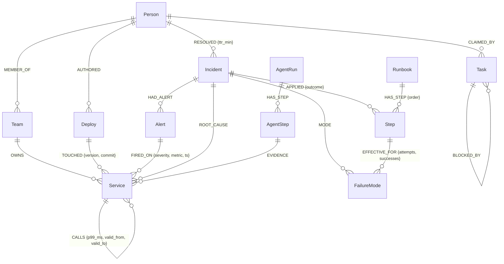

# 📐 Ripple Graph Schema Specification

This document defines the definitive Graph Ontology, Data Model, Indexes, and Constraints for **Ripple** on **FalkorDB**.

---

## 1. Graph Entity Relationship Diagram



---

## 2. Node Labels & Properties

### 2.1 Core Topology (Track 01 & 02)
| Node Label | Key Properties | Description |
| :--- | :--- | :--- |
| **`:Service`** | `id` (str, unique), `name` (str), `tier` (int: 1, 2, 3), `kind` (str), `slo_ms` (float) | Microservice in the digital twin topology. |
| **`:Team`** | `id` (str, unique), `name` (str), `slack_channel` (str), `oncall` (str) | Engineering team responsible for services. |
| **`:Person`** | `id` (str, unique), `name` (str), `email` (str), `role` (str) | Engineer, incident responder, or code author. |

### 2.2 Telemetry & Incident State (Track 01 & 02)
| Node Label | Key Properties | Description |
| :--- | :--- | :--- |
| **`:Alert`** | `id` (str, unique), `metric` (str), `value` (float), `severity` (str: critical/warning), `ts` (int) | An active symptom or alert fired by a monitoring system. |
| **`:Deploy`** | `id` (str, unique), `version` (str), `commit` (str), `ts` (int), `status` (str) | Deployment or config change made to a service. |
| **`:Incident`** | `id` (str, unique), `title` (str), `ts` (int), `severity` (str), `summary` (str) | SRE incident record combining alerts and root cause. |
| **`:FailureMode`**| `name` (str, unique), `category` (str), `description` (str) | Categorized failure type (e.g. `THREADPOOL_EXHAUSTION`, `BAD_DEPLOY`). |

### 2.3 Procedural Memory & Coordination (Track 02 & 03)
| Node Label | Key Properties | Description |
| :--- | :--- | :--- |
| **`:Step`** | `id` (str, unique), `name` (str), `command` (str), `risk_level` (str) | Remediation action (e.g., `restart_pod`, `rollback_deploy`, `trip_breaker`). |
| **`:Runbook`** | `id` (str, unique), `name` (str), `version` (str) | Standard Operating Procedure runbook document. |
| **`:Task`** | `id` (str, unique), `name` (str), `status` (str: `ready`, `claimed`, `done`), `claimed_by` (str) | Coordination task node for atomic multi-agent swarm claims. |
| **`:AgentRun`** | `id` (str, unique), `session_id` (str), `ts` (int), `status` (str) | Self-trace recording the agent's diagnosis execution graph. |
| **`:AgentStep`**| `id` (str, unique), `tool` (str), `cypher` (str), `execution_ms` (float), `rows` (int) | Granular step of agent reasoning with evidence links. |

---

## 3. Relationships & Direction Semantics

> [!IMPORTANT]
> **Direction Principle:** `(caller:Service)-[:CALLS]->(callee:Service)`  
> When a service breaks, its upstream callers degrade. Therefore:
> - **Blast Radius** = Reverse Traversal: `(broken:Service)<-[:CALLS*1..6]-(affected:Service)`
> - **Root Cause Hunt** = Forward Traversal: `(alerting:Service)-[:CALLS*0..5]->(root_candidate:Service)`

| Edge Type | Source Node | Target Node | Properties |
| :--- | :--- | :--- | :--- |
| **`:CALLS`** | `:Service` | `:Service` | `p99_ms` (float), `error_rate` (float), `valid_from` (int), `valid_to` (int) |
| **`:OWNS`** | `:Team` | `:Service` | `since` (int) |
| **`:MEMBER_OF`** | `:Person` | `:Team` | `role` (str) |
| **`:TOUCHED`** | `:Deploy` | `:Service` | `config_changed` (bool) |
| **`:AUTHORED`** | `:Person` | `:Deploy` | `reviewed_by` (str) |
| **`:FIRED_ON`** | `:Alert` | `:Service` | `threshold` (float) |
| **`:HAD_ALERT`** | `:Incident` | `:Alert` | `primary` (bool) |
| **`:ROOT_CAUSE`**| `:Incident` | `:Service` | `confidence` (float) |
| **`:MODE`** | `:Incident` | `:FailureMode` | `identified_at` (int) |
| **`:RESOLVED`** | `:Person` | `:Incident` | `ttr_min` (int) |
| **`:APPLIED`** | `:Incident` | `:Step` | `outcome` (str: `success`, `failure`), `ttr_min` (int) |
| **`:EFFECTIVE_FOR`** | `:Step` | `:FailureMode` | `attempts` (int), `successes` (int) *(Procedural Learning)* |
| **`:HAS_STEP`** | `:Runbook` | `:Step` | `order` (int) |
| **`:HAS_STEP`** | `:AgentRun` | `:AgentStep` | `sequence` (int) |
| **`:EVIDENCE`** | `:AgentStep` | `:Service` | `relevance` (float) |
| **`:BLOCKED_BY`**| `:Task` | `:Task` | `dependency_type` (str) |

---

## 4. FalkorDB Constraints & Indexes

FalkorDB supports unique constraints and range indexes. These are initialized during database startup:

```cypher
// Unique Constraints
CREATE CONSTRAINT FOR (s:Service) REQUIRE s.id IS UNIQUE;
CREATE CONSTRAINT FOR (t:Team) REQUIRE t.id IS UNIQUE;
CREATE CONSTRAINT FOR (p:Person) REQUIRE p.id IS UNIQUE;
CREATE CONSTRAINT FOR (i:Incident) REQUIRE i.id IS UNIQUE;
CREATE CONSTRAINT FOR (a:Alert) REQUIRE a.id IS UNIQUE;
CREATE CONSTRAINT FOR (d:Deploy) REQUIRE d.id IS UNIQUE;
CREATE CONSTRAINT FOR (fm:FailureMode) REQUIRE fm.name IS UNIQUE;
CREATE CONSTRAINT FOR (st:Step) REQUIRE st.id IS UNIQUE;
CREATE CONSTRAINT FOR (tk:Task) REQUIRE tk.id IS UNIQUE;

// Range Indexes for fast property filters
CREATE INDEX FOR (s:Service) ON (s.tier);
CREATE INDEX FOR (a:Alert) ON (a.ts);
CREATE INDEX FOR (d:Deploy) ON (d.ts);
CREATE INDEX FOR (i:Incident) ON (i.ts);
CREATE INDEX FOR (tk:Task) ON (tk.status);
```
